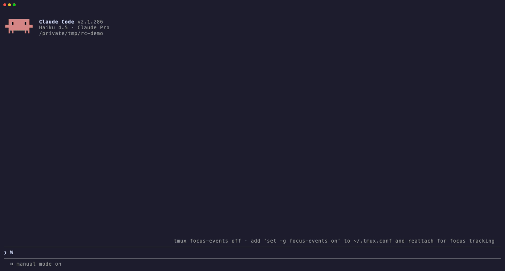

# claude-reply-comments

 

**Answer Claude point by point, right on the text.** A Claude Code mod: select any part of the conversation, write a comment on it, and send all your comments to Claude as one prompt.

> [!WARNING]
> **100% vibe coded.** Claude wrote all of this, and I have not read a single line of the code. Use it at your own discretion. I am not responsible for any weird stuff that happens while you use this mod. Mods run unsandboxed inside Claude Code, so read the source before you install it. The [MIT license](LICENSE) applies: no warranty of any kind.



## Why

The conversation is a workspace you share with Claude, but two things in it are awkward: answering a long reply from Claude full of points, lists and questions, and coming back to something said a few turns ago. Both are awkward for the same reason: you can't point at a specific place in the text and discuss it there. The prompt box only adds to the end, so you copy or restate the part you mean and write under it. This mod lets you point. Select any part of the conversation and comment right on it, and Claude gets each comment next to the exact text it's about.

| You want to… | Without it | With `/annotate` |
| --- | --- | --- |
| answer several points or questions in one reply | Copy or restate each one in the prompt and write under it | Select each one, comment, press `s` |
| answer something Claude said a while ago | Scroll the transcript, copy, paste | Jump there (`]m`, `/`, `gg`), select, comment |
| revise a plan before Claude starts | Describe the step you mean in words | Comment on the step itself |
| keep annotating while Claude works | Wait for the turn to end, or copy passages out as they appear | Open `/annotate` mid-turn and comment while new text keeps arriving |

Claude gets one prompt that quotes each span with your comment under it, and says which message each comment is on when they aren't all on the last reply.

## Install

Requires Claude Code with mods (function hooks), 2.1.286 or later. Tested on 2.1.286 in the terminal on macOS, inside tmux.

```sh
claude plugin marketplace add Malkiz/claude-reply-comments
claude plugin install reply-comments@claude-reply-comments
```

Or from a clone, for one session:

```sh
git clone https://github.com/Malkiz/claude-reply-comments.git
claude --plugin-dir ./claude-reply-comments
```

To load the clone in every session, add its folder to `CLAUDE_CODE_PLUGIN_DIRS` in the `env` block of `~/.claude/settings.json`.

For `ctrl-e` `ctrl-y` `ctrl-u` `ctrl-f` without clicking the pane first, add this to the `bindings` list in `~/.claude/keybindings.json` ([why](docs/layout-approaches.md#ctrl-keys-through-keybinding-buttons-v053)):

```json
{ "context": "PaneField", "bindings": { "ctrl+e": "select:next", "ctrl+y": "select:previous", "ctrl+f": "select:pageDown", "ctrl+u": "select:pageUp" } }
```

## Use

1. Type `/annotate`. A pane opens beside the transcript with the whole conversation, drawn the way the transcript draws it: `❯` on your prompts, `⏺` on Claude's replies, tool calls (`Bash(ls)` with its first result line) and plans, markdown rendered. It opens at the bottom, with the cursor on Claude's last reply, and it already has the keyboard.
2. Move with vim keys, or the mouse wheel.
3. Select a span (`v`, `V`, a text object such as `ip`, or a mouse drag) and press `c`. Type the comment, then Enter.
4. Repeat. `o` adds an overall comment.
5. Press `s` to send everything, or `:p` to put the prompt in the prompt box so you can edit it first.

`?` shows or hides the full key list at the bottom of the pane.

| Group | Keys |
| --- | --- |
| Move | `h j k l` · `w b e ge` (`W B E gE`) · `0 ^ $` · `gg G` (`5G` goes to line 5) · `{ }` · `]m [m` next / previous message · `H M L` · `f t F T ; ,` · counts (`3j`, `2w`) · `ctrl-e ctrl-y ctrl-u ctrl-f` (see [Install](#install)) |
| Select | `v` · `V` · `o` swaps ends · text objects `iw aw iW aW is as ip ap i( a( i[ i{ i< i" i' i\``… |
| Comment | `c` on a selection · `c{motion}` comments that span: `cip ciw ci( cc c$ c2e`… · `o` overall comment · `r` revise / `x` delete the comment under the cursor · `]c [c` next / previous comment |
| Search | `/text` then Enter (smartcase) · `n N` |
| Finish | `s` or `:w` send · `:p` put the prompt in the prompt box · `:clear` · `q` / `:q` close (the draft is kept) · `:12` go to line 12 · `zz zt zb` scroll |

More:

- **Fields.** `c`, `o`, `r`, `/` and `:` open a field at the bottom. Enter finishes, Esc cancels. An empty comment cancels, or removes the one you're revising. The field grows as a long comment wraps.
- **Esc** never takes you out of the pane. It leaves visual mode, a field or a half-typed command. `q` closes the pane.
- **The mouse.** The wheel scrolls. Dragging over text selects it and starts a comment. Clicking the conversation hands it the keyboard directly, which adds the ctrl keys; the comment is then typed in place, and `ctrl-c` cancels it.
- **While Claude works.** `/annotate` opens at once, mid-turn. While the pane is open, new prompts, replies and tool calls appear in it a block at a time, without moving your cursor or selection. Click the prompt box to type there while the pane stays open.
- **Plans.** A plan Claude presents in plan mode is drawn in full. Reject the plan dialog, run `/annotate`, comment on the steps, and send.
- **Drafts.** Unsent comments are kept when you close the pane, and are still there when you reopen it after the conversation has grown.
- **Width.** The pane docks beside the transcript at the width Claude Code keeps for every pane. Drag the divider to make it wider.

## What it reads and runs

- **Reads:** the conversation, through the hooks API (`$.session.messages()`), when you run `/annotate` and as new rows are stored while the pane is open.
- **Writes:** nothing to the conversation except the prompt you send with `s`, or the text it puts in the prompt box with `:p`. Its hook on new rows (`session.append`) passes every row through unchanged.
- **Keeps:** the draft and the pane's state in session state (`$.state`), gone when the session ends. Nothing is stored across sessions.
- **Doesn't:** read or write files, run commands, call a model or make network requests.
- **Takes over:** its own pane only. The transcript, the prompt box and every other component are left as they are.

## Limitations

- **Early access.** Mods are an early-access Claude Code surface that may change between releases. This version is checked against 2.1.286 with `claude plugin validate .` and `claude plugin test .`.
- **Terminal on macOS.** Built and tested in the terminal on macOS. The desktop Code tab draws the same reader; mobile shows the conversation as plain markdown, without selection.
- **One width for every pane.** Claude Code keeps a single dock width for all panes, and a width you've dragged wins over what a mod asks for.
- **Ctrl keys need a binding or a click.** The pane catches keys through a text field, which ctrl keys don't reach. They need the keybindings from [Install](#install) or a click on the conversation; there is no `ctrl-d` or `ctrl-b`.
- **Long conversations come in sections.** The reader is handed about 60,000 characters at a time (a mod's pane data is capped at 100,000 characters). The section moves by itself as the cursor nears its edge, and `gg` / `G` reach the very start and end, but line numbers, `:12` and `/` search cover the current section only.
- **Plain-text rendering.** The mod renders markdown itself: headings, bold and code are styled, while tables and lists show as text. Tool calls show expanded where the transcript collapses them.

## How it works

The pane draws a `Client` surface module (`hooks/reader.tsx`) that holds the conversation as one text and runs a vim engine (`hooks/vim.ts`) over it. A `Client` gets keys only after a click, so the pane also draws a text field that holds the keyboard and relays each key to the reader through `$.state`; it's redrawn with a new zero-width mark after every key so it never fills up.

Esc arrives as the pane's close (`closeOnEscape`), which the mod refuses before taking the keyboard back. The same delayed `$.ui.open({ focus })` gives the pane the keyboard right after `/annotate`. Every row is exactly one cell tall, so nothing the reader draws pushes the layout around.

The live pane watches `session.append`: new text at the end is appended in place, and a change further up (a parallel tool call's result landing, a compaction) moves comments and the cursor across, finding a changed comment again by its quote.

[`docs/layout-approaches.md`](docs/layout-approaches.md) records every layout tried on 2.1.286 (a cursor on the main transcript, a thin key pane, a floating overlay, and the wide pane chosen), with the requirements and the API limits behind each, so they can be re-tested when the API changes. The test mod behind it is in `spikes/transcript-layouts/`.

## Develop

```sh
claude plugin validate .
claude plugin test .
```

- `hooks/register.tsx`: the `/annotate` command, the pane, its key field, field and legend, Esc, the live refresh, sending and filling the prompt.
- `hooks/reader.tsx`: the `Client` surface module that draws the conversation (gutter, markdown styles, cursor, comments) and handles mouse and keys.
- `hooks/vim.ts`: the vim engine, pure functions tested in `tests/vim.test.ts`.
- `hooks/lib.ts`: the conversation as one text (`conversation`, `renderMarkdown`), the reader's window, wrapping, word, paragraph and text-object primitives, prompt building and the legend.
- `types/index.d.ts`: the `$.state` contract.

`tsconfig.json` extends `.claude-plugin/types/tsconfig.json`, which Claude Code writes when it loads the mod. That folder is gitignored.

## Ideas

- [ ] **Show past comments over the conversation.** Sent comments aren't lost: each reaches Claude as a prompt and stays in the session (and `--resume`). What disappears is the anchor. On `/annotate`, find earlier sent prompts by their format, locate each quote, and draw those comments as dimmed highlights next to the new ones. Weak spot: a quote that appears in more than one place, which anchoring by message and line would fix.
- [ ] **Later, threads:** a comment, Claude's answer, a follow-up on the same spot, and a resolved state, as in a PR review.
- **Not planned:** storing comments across sessions. A conversation doesn't outlive its session; comments on lasting artifacts (a PR, a doc) belong on the artifact.

## License

MIT. See [LICENSE](LICENSE).
